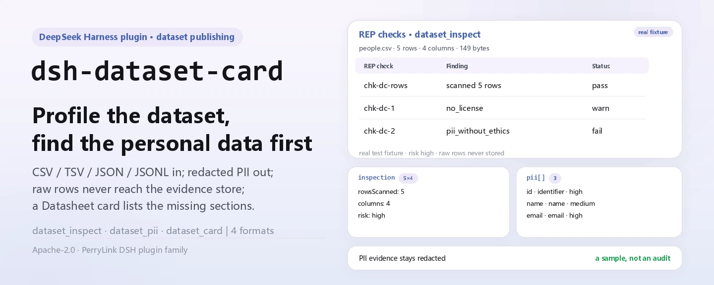
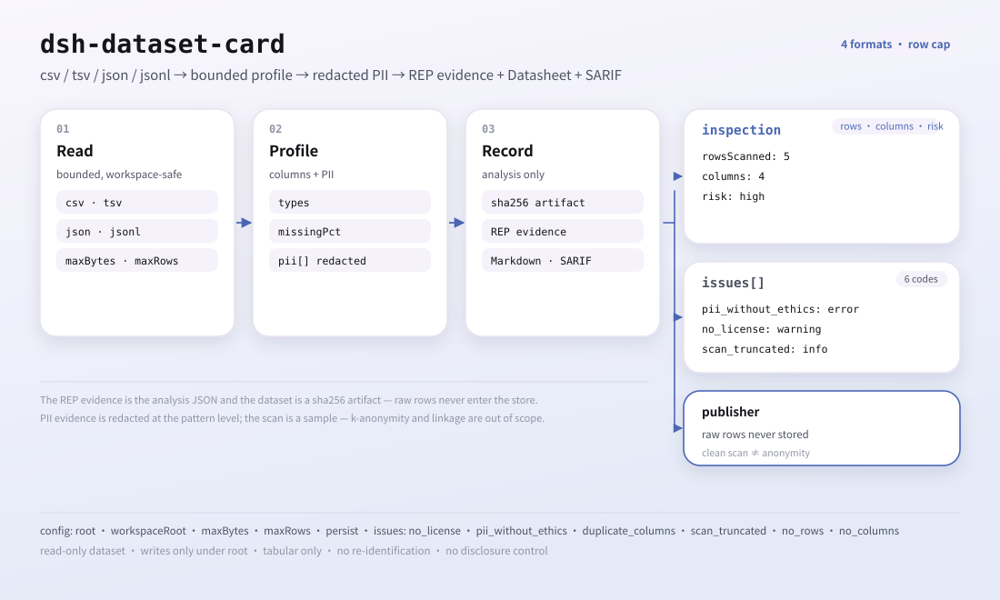
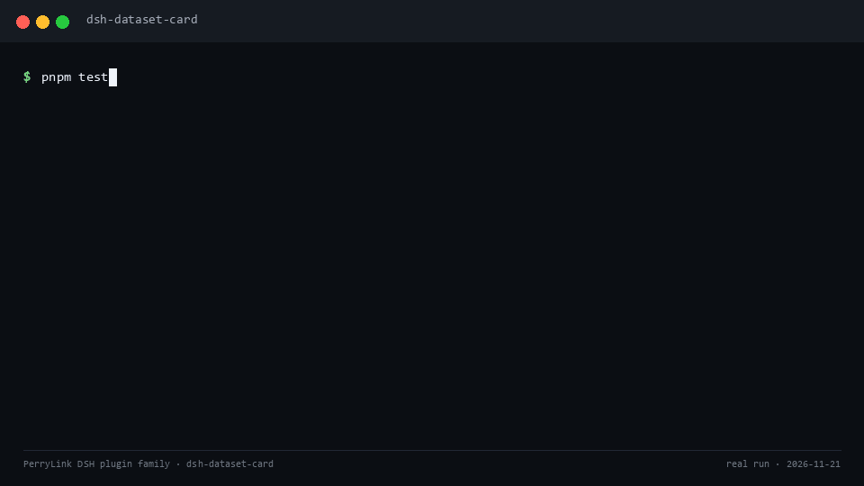

<div align="center">

<picture>
  <source media="(prefers-color-scheme: dark)" srcset="docs/assets/dsh-dataset-card-hero-en-dark.webp">
  
</picture>

# dsh-dataset-card

**Publica el conjunto de datos con una Datasheet — y sabe dónde están los datos personales antes de hacerlo.**

*Perfila CSV/TSV/JSON/JSONL con un límite de filas, marca columnas con PII por nombre y por patrones de valores ya redactados, se niega a guardar las filas crudas como evidencia y exporta una tarjeta estilo Datasheet con avisos de secciones ausentes.*

[English](README.md) · [简体中文](README-zh.md) · [Español](README-es.md) · [Português](README-pt.md) · [हिन्दी](README-hi.md)

[](LICENSE)
[]()

</div>

---

## Qué hace

- **`dataset_inspect`** — lectura acotada de `.csv`/`.tsv`/`.json`/`.jsonl`: nombres de columna, tipos inferidos, valores ausentes, cardinalidad muestreada y hallazgos de PII a partir de nombres de columna y patrones de valores (email, teléfono, documento nacional, IPv4, columnas de nombre/dirección/fecha de nacimiento/IP). Las declaraciones de licencia y ética son entradas; su ausencia se convierte en un problema.
- **`dataset_pii`** — agrupa los hallazgos redactados por tipo y riesgo y da la siguiente acción (anonimizar, restringir, registrar el consentimiento).
- **`dataset_card`** — tarjeta estilo Datasheet: Motivation, Composition (tabla de columnas), Collection, Preprocessing, Uses, Distribution, Maintenance; las secciones ausentes se listan y se convierten en avisos SARIF.


<picture>
  <source media="(prefers-color-scheme: dark)" srcset="docs/assets/dsh-dataset-card-flow-v5-dark.svg">
  
</picture>

*Estructura: leer → perfilar → registrar; `inspection` e `issues[]` son las dos salidas, y solo el análisis se convierte en evidencia — el conjunto de datos en sí queda como un artefacto sha256. Las etiquetas internas del diagrama son los nombres reales de herramientas, campos y comprobaciones, así que la misma imagen sirve para los cinco idiomas.*

## Diseño de privacidad (deliberado)

- **Los valores crudos nunca entran en la salida.** La evidencia de PII se redacta en el nivel de patrón (`***@***.***`, `1**********`, `*****************`).
- **Las filas crudas nunca entran en el almacén de evidencia.** La evidencia REP es el *análisis JSON*; el conjunto de datos se representa solo mediante un artefacto sha256.
- **El escaneo es una muestra, no una auditoría.** Un escaneo limpio no prueba el anonimato; la k-anonimidad, el enlace y los campos de texto libre quedan fuera de alcance.

## Qué no hace

- **Sin pruebas de reidentificación ni de enlace.**
- **Sin conjuntos de datos de imágenes/PDF/corpus de texto** — solo tabulares.
- **Sin Excel/Parquet.** Convierte a CSV primero.
- **Sin control estadístico de divulgación** (generalización, ruido, k-anonimidad).
- **Sin aplicación de licencias.** Registra lo que declaras.

## Comprobaciones

| Código | Gravedad | Significado |
|---|---|---|
| `no_license` | warning | no se declaró ninguna licencia |
| `pii_without_ethics` | error | columnas con PII pero sin declaración de ética/consentimiento |
| `duplicate_columns` | warning | nombres de encabezado duplicados |
| `scan_truncated` | info | se alcanzó el límite de filas (el perfil es una muestra) |
| `no_rows` | warning | hay encabezado pero no filas de datos |
| `no_columns` | error | no se analizó nada |

## Herramientas

### `dataset_inspect`

`{ path, label?, license?, ethics?, persist? }` → `{ ok, inspection, evidenceId?, recordPath? }`.

### `dataset_pii`

`{ inspection }` → `{ ok, summary: { risk, byKind, findings, recommendations } }`.

### `dataset_card`

`{ inspection, title?, description?, creators?, license?, ethics?, doi?, motivation?, composition?, collection?, preprocessing?, uses?, distribution?, maintenance? }` → `{ ok, card, markdown, sarif }`.

### Códigos de error

`INVALID_INPUT` · `NOT_FOUND` · `PATH_ESCAPE` · `NOT_A_FILE` · `TOO_LARGE` · `UNSUPPORTED_FORMAT` · `PARSE_ERROR` · `STORE_ERROR`

## Compatibilidad e instalación

| | |
|---|---|
| DeepSeek Harness | **`dsh-v0.2.2-rc.4`** (verificado 2026-11-18); peer `>=0.2.1-0 <0.3.0 \|\| >=0.2.2-0 <0.3.0` |
| Node | `^22.19.0 \|\| >=24.9.0` (probado en `24.22.1`), solo ESM |
| Pares | `@perrylink/dsh-research-core ^0.1.0`, `@deepseek-ai/cordis ^4.0.5-alpha.1`, `@deepseek-ai/dsh-tools`, `@deepseek-ai/schemastery ^3.18.5-alpha.1` |
| Dependencias en tiempo de ejecución | **cero** |

```sh
dsh plugin --profile <name> add @perrylink/dsh-research-core dsh-dataset-card
dsh --profile <name> --dump-config | grep dsh-dataset-card
```

## Configuración

| Clave | Predeterminado | Significado |
|---|---|---|
| `enabled` | `true` | `false` no monta nada |
| `root` | `.dataset-card` | raíz del almacén y de los registros |
| `workspaceRoot` | `process.cwd()` | las rutas del conjunto de datos deben resolverse dentro de él |
| `maxBytes` | `20971520` | límite de tamaño (falla, nunca trunca) |
| `maxRows` | `10000` | filas escaneadas para el perfil |
| `persist` | `true` | guarda el análisis (no las filas) como evidencia REP |

## Límites de seguridad

- Solo lectura sobre el conjunto de datos; escrituras solo bajo `root`.
- Contención mediante `realpath`; las extensiones no admitidas se rechazan antes de leer.
- La instantánea de la evidencia es el análisis JSON; una prueba verifica que el texto del registro no contiene la PII del fixture.
- Los valores solo se usan para coincidencia de patrones; nunca se registran en logs.

## Evaluación



*Animado: la salida real de `pnpm test` el 2026-11-21 (3 archivos de prueba). El plugin no tiene CLI, así que su propio conjunto de pruebas es la ejecución — análisis, redacción, el registro REP y la tarjeta Datasheet.*


**13 pruebas**: análisis de CSV entre comillas (comas incrustadas, comillas escapadas, saltos de línea), inferencia de tipos, perfilado de columnas y valores ausentes, detección de PII por nombre de columna y patrón de valores con una aserción de no filtración, problemas de licencia ausente y de PII sin ética, análisis de JSON/TSV, truncado por límite de filas, tiempo de ejecución (validez del registro, evidencia solo de análisis, artefacto de datos sha256), rechazo de rutas de escape/formato no admitido/tamaño excesivo/error de análisis/forma incorrecta, protecciones de las herramientas ante inspecciones malformadas, esquemas de las herramientas, de inspección a PII y a tarjeta de extremo a extremo, ramas de fallo y contrato del paquete.

No se declara ningún benchmark: esto es un perfilador basado en reglas; su corrección son la redacción y las comprobaciones, ambas fijadas por fixtures.

## Limitaciones conocidas (v0.1)

- La detección de PII se basa en patrones; los nombres en columnas de texto libre, las direcciones sin palabras clave y los cuasi-identificadores enlazados pueden pasarse por alto.
- La cardinalidad se muestrea sobre la ventana de escaneo, no sobre el conjunto completo.
- El análisis de CSV asume una fila de encabezado y ningún metadato de tipos.
- La tarjeta nunca verifica las afirmaciones que escribes en ella.

## Licencia

Apache-2.0. Ningún código de terceros en tiempo de ejecución.
