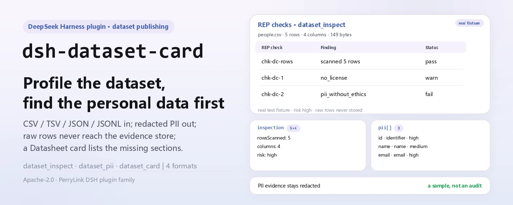
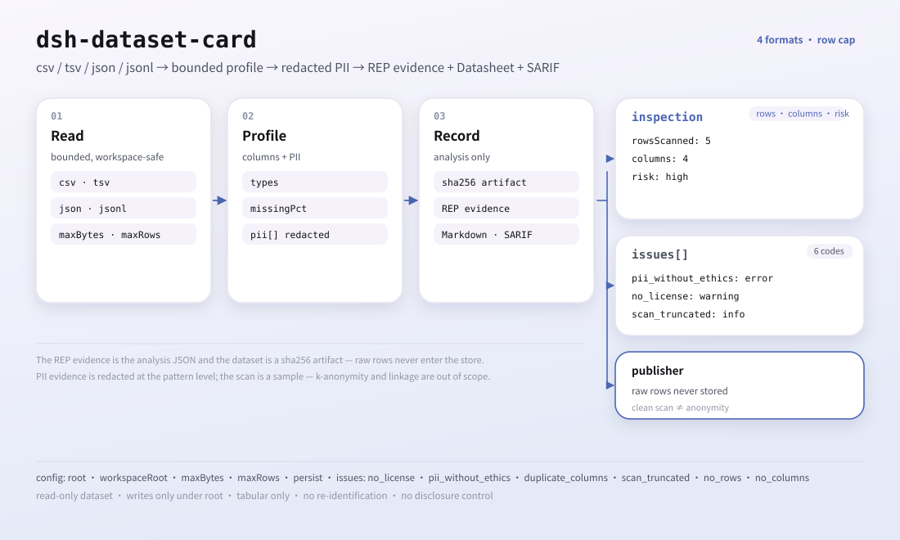
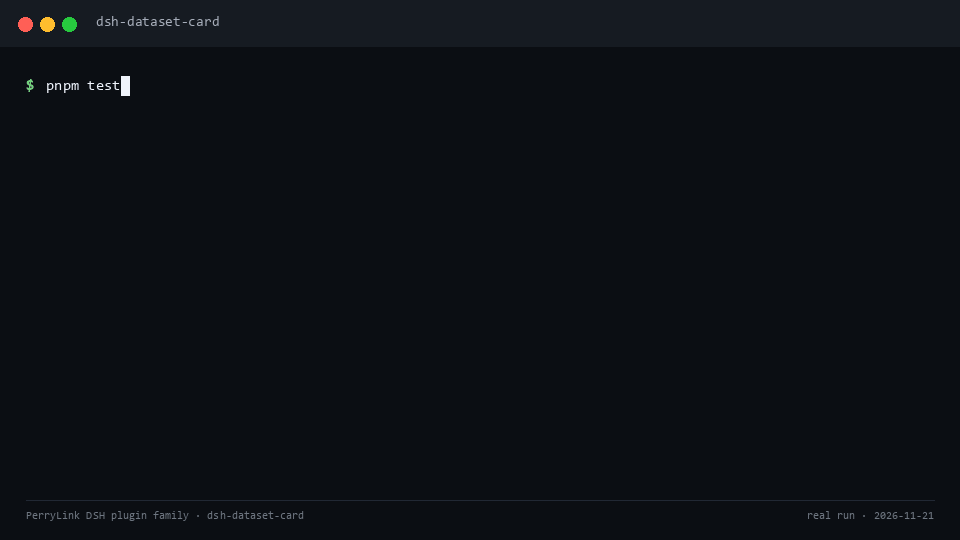

<div align="center">

<picture>
  <source media="(prefers-color-scheme: dark)" srcset="docs/assets/dsh-dataset-card-hero-en-dark.webp">
  
</picture>

# dsh-dataset-card

**डेटासेट को Datasheet के साथ प्रकाशित करें — और प्रकाशित करने से पहले जानें कि व्यक्तिगत डेटा कहाँ है।**

*पंक्ति सीमा के साथ CSV/TSV/JSON/JSONL की प्रोफ़ाइल बनाता है, कॉलम नाम और redact किए गए मान पैटर्न से PII-जैसे कॉलम चिह्नित करता है, कच्ची पंक्तियों को साक्ष्य के रूप में संग्रहीत करने से इनकार करता है, और अनुपस्थित अनुभाग चेतावनियों के साथ Datasheet-शैली कार्ड निर्यात करता है।*

[English](README.md) · [简体中文](README-zh.md) · [Español](README-es.md) · [Português](README-pt.md) · [हिन्दी](README-hi.md)

[](LICENSE)
[]()

</div>

---

## यह क्या करता है

- **`dataset_inspect`** — `.csv`/`.tsv`/`.json`/`.jsonl` की सीमित पढ़ाई: कॉलम नाम, अनुमानित प्रकार, अनुपस्थिति, नमूनाकृत cardinality, और कॉलम नाम व मान पैटर्न से PII निष्कर्ष (email, फ़ोन, राष्ट्रीय आईडी, IPv4, नाम/पता/जन्मतिथि/IP कॉलम)। लाइसेंस और नैतिकता कथन इनपुट हैं; उनकी अनुपस्थिति एक समस्या बन जाती है।
- **`dataset_pii`** — redact किए गए निष्कर्षों को प्रकार और जोखिम के अनुसार समूहित करता है और अगली कार्रवाई देता है (de-identify, प्रतिबंधित करें, सहमति दर्ज करें)।
- **`dataset_card`** — Datasheet-शैली कार्ड: Motivation, Composition (कॉलम तालिका), Collection, Preprocessing, Uses, Distribution, Maintenance; अनुपस्थित अनुभाग सूचीबद्ध होते हैं और SARIF चेतावनियाँ बनते हैं।

<picture>
  <source media="(prefers-color-scheme: dark)" srcset="docs/assets/dsh-dataset-card-flow-v5-dark.svg">
  
</picture>

*संरचना: पढ़ें → प्रोफ़ाइल बनाएँ → दर्ज करें; `inspection` और `issues[]` दो आउटपुट हैं, और केवल विश्लेषण साक्ष्य बनता है — डेटासेट स्वयं एक sha256 artifact रहता है। आरेख के अंदर के टोकन लेबल असली टूल, फ़ील्ड और जाँच नाम हैं, इसलिए एक ही चित्र पाँचों भाषाओं के लिए काम करता है।*

## गोपनीयता डिज़ाइन (जानबूझकर)

- **कच्चे मान कभी आउटपुट में नहीं आते।** PII साक्ष्य पैटर्न स्तर पर redact होता है (`***@***.***`, `1**********`, `*****************`)।
- **कच्ची पंक्तियाँ कभी साक्ष्य भंडार में नहीं जातीं।** REP साक्ष्य *विश्लेषण JSON* है; डेटासेट केवल sha256 artifact द्वारा प्रदर्शित होता है।
- **स्कैन एक नमूना है, ऑडिट नहीं।** साफ़ स्कैन गुमनामी का प्रमाण नहीं है; k-anonymity, linkage और free-text फ़ील्ड दायरे से बाहर हैं।

## यह क्या नहीं करता

- **कोई re-identification या linkage परीक्षण नहीं।**
- **कोई छवि/PDF/पाठ-कॉर्पस डेटासेट नहीं** — केवल सारणीबद्ध।
- **Excel/Parquet नहीं।** पहले CSV में बदलें।
- **कोई सांख्यिकीय प्रकटीकरण नियंत्रण नहीं** (सामान्यीकरण, शोर, k-anonymity)।
- **कोई लाइसेंस प्रवर्तन नहीं।** जो आप घोषित करते हैं वही दर्ज होता है।

## जाँचें

| कोड | गंभीरता | अर्थ |
|---|---|---|
| `no_license` | warning | कोई लाइसेंस घोषित नहीं |
| `pii_without_ethics` | error | PII-जैसे कॉलम लेकिन नैतिकता/सहमति कथन नहीं |
| `duplicate_columns` | warning | डुप्लिकेट हेडर नाम |
| `scan_truncated` | info | पंक्ति सीमा पूरी (प्रोफ़ाइल नमूना है) |
| `no_rows` | warning | हेडर है पर डेटा पंक्तियाँ नहीं |
| `no_columns` | error | कुछ भी पार्स नहीं हुआ |

## टूल

### `dataset_inspect`

`{ path, label?, license?, ethics?, persist? }` → `{ ok, inspection, evidenceId?, recordPath? }`.

### `dataset_pii`

`{ inspection }` → `{ ok, summary: { risk, byKind, findings, recommendations } }`.

### `dataset_card`

`{ inspection, title?, description?, creators?, license?, ethics?, doi?, motivation?, composition?, collection?, preprocessing?, uses?, distribution?, maintenance? }` → `{ ok, card, markdown, sarif }`.

### त्रुटि कोड

`INVALID_INPUT` · `NOT_FOUND` · `PATH_ESCAPE` · `NOT_A_FILE` · `TOO_LARGE` · `UNSUPPORTED_FORMAT` · `PARSE_ERROR` · `STORE_ERROR`

## संगतता और इंस्टॉल

| | |
|---|---|
| DeepSeek Harness | **`dsh-v0.2.3-alpha.1`** (2026-11-22 को सत्यापित); peer `>=0.2.1-0 <0.3.0 \|\| >=0.2.2-0 <0.3.0` |
| Node | `^22.19.0 \|\| >=24.9.0` (`24.22.1` पर परीक्षित), केवल ESM |
| Peer | `@perrylink/dsh-research-core ^0.1.0`, `@deepseek-ai/cordis ^4.0.5-alpha.1`, `@deepseek-ai/dsh-tools`, `@deepseek-ai/schemastery ^3.18.5-alpha.1` |
| रनटाइम निर्भरताएँ | **शून्य** |

```sh
dsh plugin --profile <name> add @perrylink/dsh-research-core dsh-dataset-card
dsh --profile <name> --dump-config | grep dsh-dataset-card
```

## कॉन्फ़िगरेशन

| कुंजी | डिफ़ॉल्ट | अर्थ |
|---|---|---|
| `enabled` | `true` | `false` होने पर कुछ भी माउंट नहीं होता |
| `root` | `.dataset-card` | स्टोर/रिकॉर्ड की जड़ |
| `workspaceRoot` | `process.cwd()` | डेटासेट के पथ इसी के अंदर हल होने चाहिए |
| `maxBytes` | `20971520` | फ़ाइल सीमा (विफल होती है, कभी काटती नहीं) |
| `maxRows` | `10000` | प्रोफ़ाइल के लिए स्कैन की गई पंक्तियाँ |
| `persist` | `true` | विश्लेषण (पंक्तियाँ नहीं) REP साक्ष्य के रूप में रखें |

## सुरक्षा सीमाएँ

- डेटासेट पर केवल पढ़ें; लिखें केवल `root` के अंतर्गत।
- `realpath` containment; असमर्थित एक्सटेंशन पढ़ने से पहले अस्वीकार किए जाते हैं।
- साक्ष्य snapshot विश्लेषण JSON है; एक टेस्ट जाँचता है कि रिकॉर्ड टेक्स्ट में fixture की PII नहीं है।
- मान केवल पैटर्न मिलान के लिए उपयोग होते हैं; कभी लॉग नहीं होते।

## मूल्यांकन



*एनिमेटेड: 2026-11-21 को असली `pnpm test` का आउटपुट (3 टेस्ट फ़ाइलें)। इस प्लगइन में CLI नहीं है, इसलिए उसका अपना टेस्ट सूट ही रन है — पार्सिंग, redaction, REP रिकॉर्ड और Datasheet कार्ड।*

**14 टेस्ट**: उद्धृत CSV पार्सिंग (एम्बेडेड अल्पविराम, escaped उद्धरण, नई पंक्तियाँ), प्रकार अनुमान, कॉलम प्रोफ़ाइलिंग और अनुपस्थिति, कॉलम नाम व मान पैटर्न से PII पहचान और no-leak assertion, लाइसेंस अनुपस्थित तथा नैतिकता के बिना PII की समस्याएँ, JSON/TSV पार्सिंग, पंक्ति-सीमा truncation, रनटाइम (रिकॉर्ड की वैधता, केवल-विश्लेषण साक्ष्य, sha256 डेटा artifact), traversal/असमर्थित/अत्यधिक आकार/parse-error/shape की अस्वीकृति, विकृत inspection के विरुद्ध टूल गार्ड, टूल स्कीमा, inspect→pii→card एंड-टू-एंड, विफलता शाखाएँ, पैकेज कॉन्ट्रैक्ट।

किसी बेंचमार्क का दावा नहीं: यह नियम-आधारित प्रोफ़ाइलर है; इसकी शुद्धता redaction और जाँचें हैं, दोनों fixture द्वारा तय।

## ज्ञात सीमाएँ (v0.1)

- PII पहचान पैटर्न-आधारित है; free-text कॉलमों के नाम, कीवर्ड के बिना पते और जुड़े quasi-identifiers छूट सकते हैं।
- Cardinality स्कैन विंडो पर नमूनाकृत है, पूरे डेटासेट पर नहीं।
- CSV पार्सिंग एक हेडर पंक्ति और कोई प्रकार मेटाडेटा न होने की धारणा करती है।
- कार्ड आपके लिखे दावों को कभी सत्यापित नहीं करता।

## लाइसेंस

Apache-2.0. रनटाइम में कोई तृतीय-पक्ष कोड नहीं।
