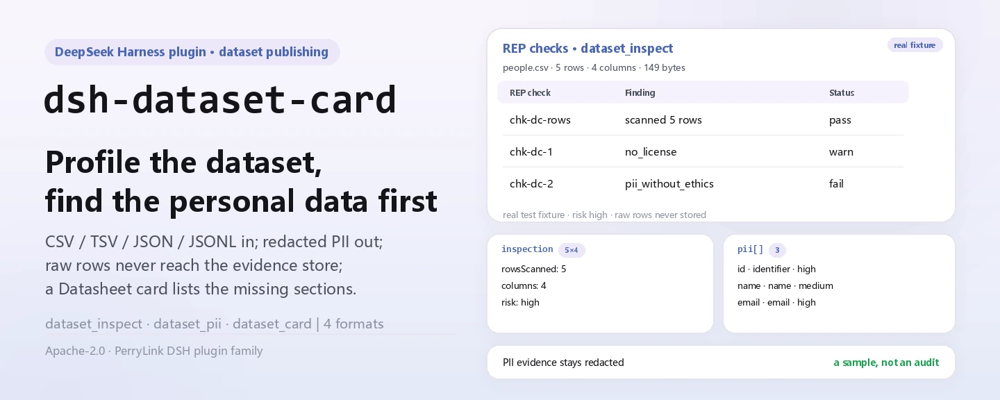
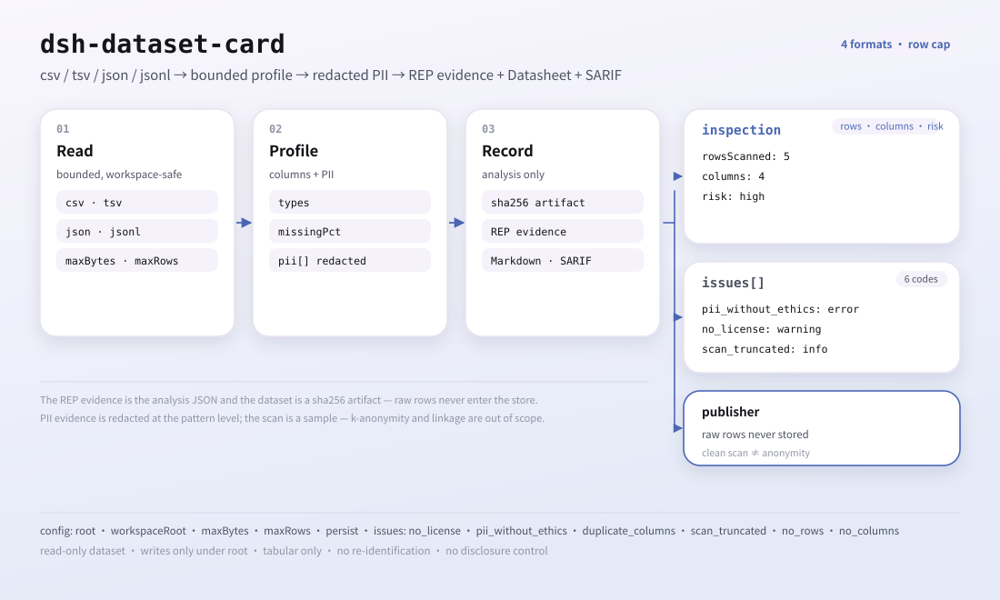
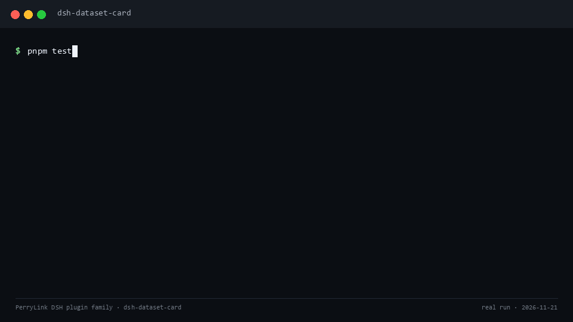

<div align="center">

<picture>
  <source media="(prefers-color-scheme: dark)" srcset="docs/assets/dsh-dataset-card-hero-en-dark.webp">
  
</picture>

# dsh-dataset-card

**Publique o conjunto de dados com uma Datasheet — e saiba onde estão os dados pessoais antes de fazê-lo.**

*Perfila CSV/TSV/JSON/JSONL com um limite de linhas, sinaliza colunas com PII por nome e por padrões de valores já redigidos, recusa-se a armazenar as linhas brutas como evidência e exporta um cartão estilo Datasheet com avisos de seções ausentes.*

[English](README.md) · [简体中文](README-zh.md) · [Español](README-es.md) · [Português](README-pt.md) · [हिन्दी](README-hi.md)

[](LICENSE)
[]()

</div>

---

## O que faz

- **`dataset_inspect`** — leitura limitada de `.csv`/`.tsv`/`.json`/`.jsonl`: nomes de coluna, tipos inferidos, ausências, cardinalidade amostrada e achados de PII a partir de nomes de coluna e padrões de valores (email, telefone, documento nacional, IPv4, colunas de nome/endereço/data de nascimento/IP). As declarações de licença e ética são entradas; sua ausência vira um problema.
- **`dataset_pii`** — agrupa os achados redigidos por tipo e risco e indica a próxima ação (anonimizar, restringir, registrar consentimento).
- **`dataset_card`** — cartão estilo Datasheet: Motivation, Composition (tabela de colunas), Collection, Preprocessing, Uses, Distribution, Maintenance; as seções ausentes são listadas e se tornam avisos SARIF.


<picture>
  <source media="(prefers-color-scheme: dark)" srcset="docs/assets/dsh-dataset-card-flow-v5-dark.svg">
  
</picture>

*Estrutura: ler → perfilar → registrar; `inspection` e `issues[]` são as duas saídas, e apenas a análise se torna evidência — o conjunto de dados em si permanece um artefato sha256. Os rótulos internos do diagrama são os nomes reais de ferramentas, campos e verificações, então a mesma imagem serve aos cinco idiomas.*

## Design de privacidade (proposital)

- **Valores brutos nunca entram na saída.** A evidência de PII é redigida no nível do padrão (`***@***.***`, `1**********`, `*****************`).
- **Linhas brutas nunca entram no armazenamento de evidências.** A evidência REP é o *JSON de análise*; o conjunto de dados é representado apenas por um artefato sha256.
- **A varredura é uma amostra, não uma auditoria.** Uma varredura limpa não prova anonimato; k-anonimato, vinculação e campos de texto livre estão fora do escopo.

## O que não faz

- **Sem testes de reidentificação ou vinculação.**
- **Sem conjuntos de dados de imagem/PDF/corpus de texto** — apenas tabulares.
- **Sem Excel/Parquet.** Converta para CSV primeiro.
- **Sem controle estatístico de divulgação** (generalização, ruído, k-anonimato).
- **Sem aplicação de licenças.** Registra o que você declara.

## Verificações

| Código | Gravidade | Significado |
|---|---|---|
| `no_license` | warning | nenhuma licença declarada |
| `pii_without_ethics` | error | colunas com PII mas sem declaração de ética/consentimento |
| `duplicate_columns` | warning | nomes de cabeçalho duplicados |
| `scan_truncated` | info | limite de linhas atingido (o perfil é uma amostra) |
| `no_rows` | warning | cabeçalho mas nenhuma linha de dados |
| `no_columns` | error | nada foi analisado |

## Ferramentas

### `dataset_inspect`

`{ path, label?, license?, ethics?, persist? }` → `{ ok, inspection, evidenceId?, recordPath? }`.

### `dataset_pii`

`{ inspection }` → `{ ok, summary: { risk, byKind, findings, recommendations } }`.

### `dataset_card`

`{ inspection, title?, description?, creators?, license?, ethics?, doi?, motivation?, composition?, collection?, preprocessing?, uses?, distribution?, maintenance? }` → `{ ok, card, markdown, sarif }`.

### Códigos de erro

`INVALID_INPUT` · `NOT_FOUND` · `PATH_ESCAPE` · `NOT_A_FILE` · `TOO_LARGE` · `UNSUPPORTED_FORMAT` · `PARSE_ERROR` · `STORE_ERROR`

## Compatibilidade e instalação

| | |
|---|---|
| DeepSeek Harness | **`dsh-v0.2.2-rc.4`** (verificado em 2026-11-18); peer `>=0.2.1-0 <0.3.0 \|\| >=0.2.2-0 <0.3.0` |
| Node | `^22.19.0 \|\| >=24.9.0` (testado em `24.22.1`), apenas ESM |
| Pares | `@perrylink/dsh-research-core ^0.1.0`, `@deepseek-ai/cordis ^4.0.5-alpha.1`, `@deepseek-ai/dsh-tools`, `@deepseek-ai/schemastery ^3.18.5-alpha.1` |
| Dependências de execução | **zero** |

```sh
dsh plugin --profile <name> add @perrylink/dsh-research-core dsh-dataset-card
dsh --profile <name> --dump-config | grep dsh-dataset-card
```

## Configuração

| Chave | Padrão | Significado |
|---|---|---|
| `enabled` | `true` | `false` não monta nada |
| `root` | `.dataset-card` | raiz do armazenamento e dos registros |
| `workspaceRoot` | `process.cwd()` | os caminhos do conjunto de dados devem resolver dentro dele |
| `maxBytes` | `20971520` | limite de tamanho (falha, nunca trunca) |
| `maxRows` | `10000` | linhas varridas para o perfil |
| `persist` | `true` | armazena a análise (não as linhas) como evidência REP |

## Limites de segurança

- Somente leitura sobre o conjunto de dados; escritas apenas sob `root`.
- Contenção por `realpath`; extensões não suportadas são rejeitadas antes da leitura.
- O snapshot da evidência é o JSON de análise; um teste garante que o texto do registro não contém a PII do fixture.
- Os valores só são usados para correspondência de padrões; nunca são registrados em logs.

## Avaliação



*Animado: a saída real de `pnpm test` em 2026-11-21 (3 arquivos de teste). O plugin não tem CLI, então seu próprio conjunto de testes é a execução — análise, redação, o registro REP e o cartão Datasheet.*


**13 testes**: análise de CSV com aspas (vírgulas embutidas, aspas escapadas, quebras de linha), inferência de tipos, perfil de colunas e ausências, detecção de PII por nome de coluna e padrão de valores com uma asserção de não vazamento, problemas de licença ausente e de PII sem ética, análise de JSON/TSV, truncamento por limite de linhas, execução (validade do registro, evidência apenas de análise, artefato de dados sha256), rejeição de travessia/formato não suportado/tamanho excessivo/erro de análise/forma incorreta, proteções das ferramentas contra inspeções malformadas, esquemas das ferramentas, de inspeção a PII e a cartão de ponta a ponta, ramos de falha e contrato do pacote.

Nenhum benchmark é declarado: este é um perfilador baseado em regras; sua correção são a redação e as verificações, ambas fixadas por fixtures.

## Limitações conhecidas (v0.1)

- A detecção de PII é baseada em padrões; nomes em colunas de texto livre, endereços sem palavras-chave e quase-identificadores vinculados podem passar despercebidos.
- A cardinalidade é amostrada na janela de varredura, não no conjunto completo.
- A análise de CSV assume uma linha de cabeçalho e nenhum metadado de tipo.
- O cartão nunca verifica as afirmações que você escreve nele.

## Licença

Apache-2.0. Nenhum código de terceiros em tempo de execução.
