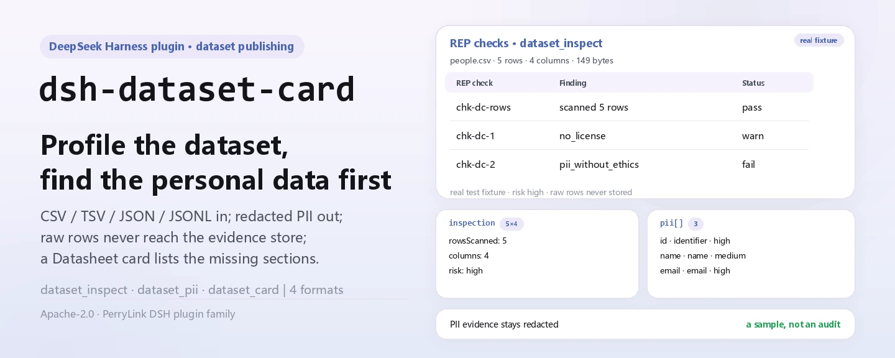
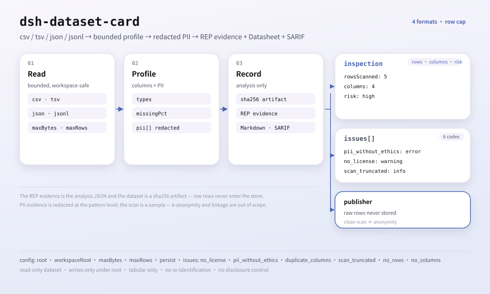
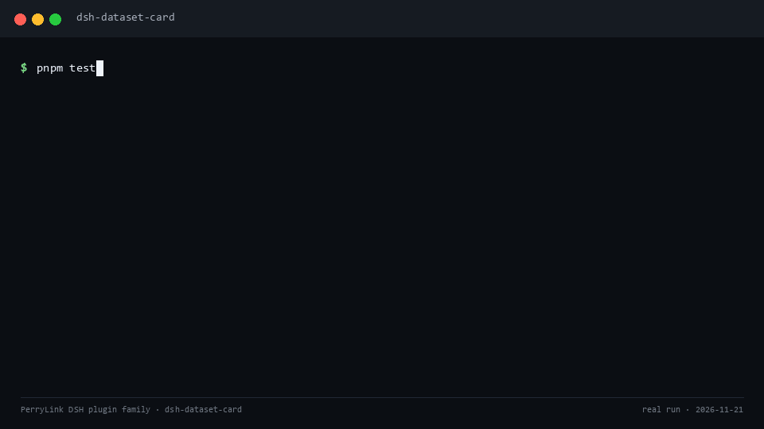

<div align="center">

<picture>
  <source media="(prefers-color-scheme: dark)" srcset="docs/assets/dsh-dataset-card-hero-en-dark.webp">
  
</picture>

# dsh-dataset-card

**Publish the dataset with a Datasheet — and know where the personal data is before you do.**

*Profiles CSV/TSV/JSON/JSONL with a row cap, flags PII-like columns by name and redacted value patterns, refuses to store raw rows as evidence, and exports a Datasheet-style card with missing-section warnings.*

[简体中文](README-zh.md) · [Español](README-es.md) · [Português](README-pt.md) · [हिन्दी](README-hi.md)

[](LICENSE)
[]()

</div>

---

## What it does

- **`dataset_inspect`** — bounded read of `.csv`/`.tsv`/`.json`/`.jsonl`: column names, inferred types, missingness, sampled cardinality, and PII findings from column names and value patterns (email, phone, national ID, IPv4, name/address/DOB/IP columns). License and ethics statements are inputs; their absence becomes an issue.
- **`dataset_pii`** — groups the redacted findings by kind and risk and gives the next action (de-identify, restrict, record consent).
- **`dataset_card`** — Datasheet-style card: Motivation, Composition (column table), Collection, Preprocessing, Uses, Distribution, Maintenance; missing sections are listed and become SARIF warnings.

<picture>
  <source media="(prefers-color-scheme: dark)" srcset="docs/assets/dsh-dataset-card-flow-v5-dark.svg">
  
</picture>

*Structure: read → profile → record; the `inspection` and `issues[]` are the two outputs, and only the analysis becomes evidence — the dataset itself stays a sha256 artifact. The token labels inside the diagram are the real tool, field and check names, so the same picture serves all five languages.*

## Privacy design (deliberate)

- **Raw values never enter the output.** PII evidence is redacted at the pattern level (`***@***.***`, `1**********`, `*****************`).
- **Raw rows never enter the evidence store.** The REP evidence is the *analysis JSON*; the dataset is represented by a sha256 artifact only.
- **The scan is a sample, not an audit.** A clean scan is not proof of anonymity; k-anonymity, linkage and free-text fields are out of scope.

## What it does not do

- **No re-identification or linkage testing.**
- **No image/PDF/text-corpus datasets** — tabular only.
- **No Excel/Parquet.** Convert to CSV first.
- **No statistical disclosure control** (generalisation, noise, k-anonymity).
- **No licence enforcement.** It records what you declare.

## Checks

| Code | Severity | Meaning |
|---|---|---|
| `no_license` | warning | no license declared |
| `pii_without_ethics` | error | PII-like columns but no ethics/consent statement |
| `duplicate_columns` | warning | duplicate header names |
| `scan_truncated` | info | row cap reached (profile is a sample) |
| `no_rows` | warning | header but no data rows |
| `no_columns` | error | nothing parsed |

## Tools

### `dataset_inspect`

`{ path, label?, license?, ethics?, persist? }` → `{ ok, inspection, evidenceId?, recordPath? }`.

### `dataset_pii`

`{ inspection }` → `{ ok, summary: { risk, byKind, findings, recommendations } }`.

### `dataset_card`

`{ inspection, title?, description?, creators?, license?, ethics?, doi?, motivation?, composition?, collection?, preprocessing?, uses?, distribution?, maintenance? }` → `{ ok, card, markdown, sarif }`.

### Error codes

`INVALID_INPUT` · `NOT_FOUND` · `PATH_ESCAPE` · `NOT_A_FILE` · `TOO_LARGE` · `UNSUPPORTED_FORMAT` · `PARSE_ERROR` · `STORE_ERROR`

## Compatibility & install

| | |
|---|---|
| DeepSeek Harness | **`dsh-v0.2.3-alpha.1`** (verified 2026-11-22); peer `>=0.2.1-0 <0.3.0 \|\| >=0.2.2-0 <0.3.0` |
| Node | `^22.19.0 \|\| >=24.9.0` (tested `24.22.1`), ESM only |
| Peers | `@perrylink/dsh-research-core ^0.1.0`, `@deepseek-ai/cordis ^4.0.5-alpha.1`, `@deepseek-ai/dsh-tools`, `@deepseek-ai/schemastery ^3.18.5-alpha.1` |
| Runtime dependencies | **zero** |

```sh
dsh plugin --profile <name> add @perrylink/dsh-research-core dsh-dataset-card
dsh --profile <name> --dump-config | grep dsh-dataset-card
```

## Configuration

| Key | Default | Meaning |
|---|---|---|
| `enabled` | `true` | `false` mounts nothing |
| `root` | `.dataset-card` | store/record root |
| `workspaceRoot` | `process.cwd()` | dataset paths must resolve inside it |
| `maxBytes` | `20971520` | file cap (fails, never truncates) |
| `maxRows` | `10000` | rows scanned for the profile |
| `persist` | `true` | store the analysis (not rows) as REP evidence |

## Security boundaries

- Read-only on the dataset; writes only under `root`.
- `realpath` containment; unsupported extensions rejected before reading.
- The evidence snapshot is the analysis JSON; a test asserts the record text does not contain fixture PII.
- Values are only ever used for pattern matching; they are not logged.

## Evaluation



*Animated: the real `pnpm test` output on 2026-11-21 (3 test files). The plugin has no CLI, so its own suite is the run — parsing, redaction, the REP record and the Datasheet card.*

**14 tests**: quoted CSV parsing (embedded commas, escaped quotes, newlines), type inference, column profiling and missingness, PII detection by column name and value pattern with a no-leak assertion, missing-license and PII-without-ethics issues, JSON/TSV parsing, row-cap truncation, runtime (record validity, analysis-only evidence, sha256 data artifact), traversal/unsupported/oversize/parse-error/shape rejection, malformed-inspection tool guards, tool schemas, inspect→pii→card end to end, failure branches, package contract.

No benchmark is claimed: this is a rule-based profiler; its correctness is the redaction and the checks, both pinned by fixtures.

## Known limitations (v0.1)

- PII detection is pattern-based; names in free-text columns, addresses without keywords and linked quasi-identifiers can be missed.
- Cardinality is sampled over the scan window, not the full dataset.
- CSV parsing assumes one header row and no type metadata.
- The card never verifies the claims you write into it.

## License

Apache-2.0. No third-party runtime code.
